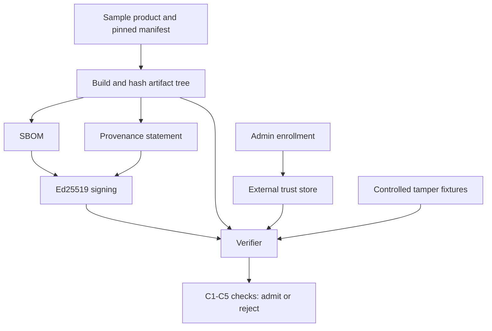
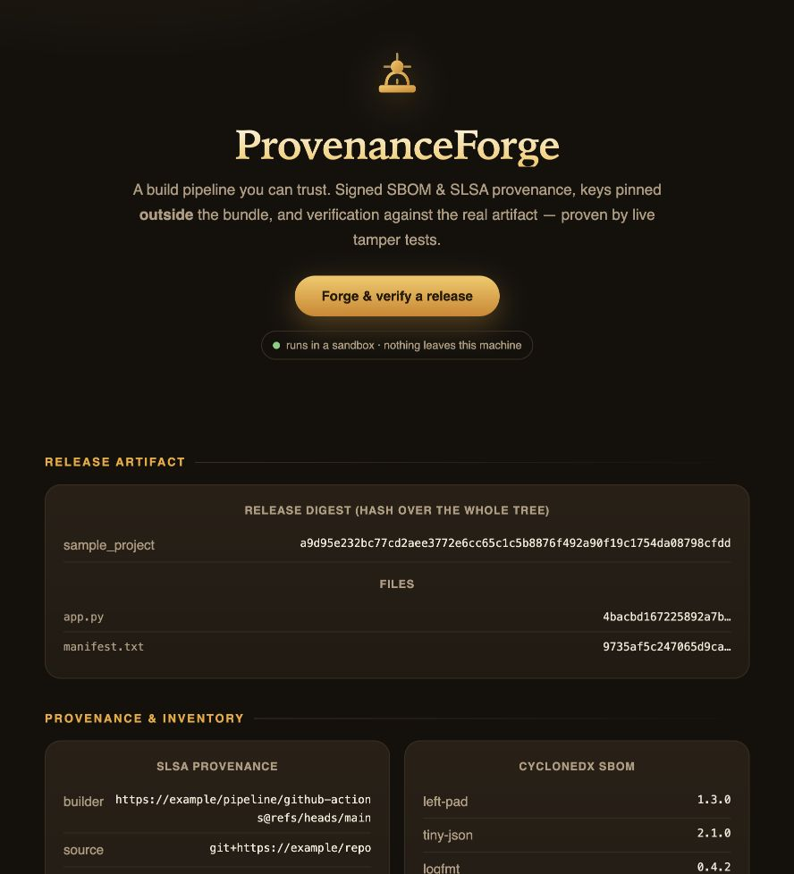

# ProvenanceForge-SLSA

A local build-verification exercise that signs an SBOM and SLSA-style provenance, pins trusted keys outside the bundle, and rejects controlled tampering.

[](https://github.com/harshacreate/ProvenanceForge-SLSA/actions/workflows/ci.yml)

## Problem / why it matters

A software release can be changed after build, or its provenance and inventory can disagree. Verification is meaningful only when it checks the artifact itself and compares signatures against a trust anchor managed independently of the bundle. This repository demonstrates those boundaries on a small local fixture.

## What I built

The build step hashes a bundled sample product, emits a minimal CycloneDX-shaped SBOM and an in-toto/SLSA-style provenance statement, and signs both with Ed25519. A separate enrollment step places the builder's public key in a trust store. Verification then checks the signature, builder identity, recomputed artifact digest, SBOM/material agreement, and pinned dependency versions.



### Dashboard



## Results / evaluation

**CONTROLLED FIXTURES only.** Measured locally with `python3 -m tamper.experiments`:

| Measure | Result |
|---|---:|
| Tamper cases rejected | 6 / 6 |
| Untampered control admitted | yes |
| Average local build time | 0.35 ms/build in this run |
| Unit tests | 9 passed |

Tamper cases include a dependency swap, artifact digest mismatch, unapproved builder, forged key, stale provenance signature, and SBOM/provenance mismatch. Timings are environment-specific and not a performance claim.

## Design decisions and lessons to discuss

- The verifier resolves a key from an external trust store by builder identity; it does not trust the bundle's key hint as an authority.
- Build and trust enrollment are separate operations so the build cannot enroll its own key as a side effect.
- The verifier recomputes the artifact-tree digest rather than accepting the claimed digest at face value.
- This is a prototype, not a complete SLSA verifier: the component hashes are deterministic stand-ins, the sample manifest is local, and no CI identity, KMS, registry, transparency log, or official provenance validator is used.

## Run it

### Docker dashboard

```bash
docker compose up --build
# Open http://127.0.0.1:8093
```

### Local tests and pipeline

```bash
python3 -m venv .venv
source .venv/bin/activate
python -m pip install -r requirements.txt
make test
make verify
make tamper
```

`make verify` is a local demo flow: it builds the fixture, enrolls the generated builder key, and verifies the artifact. Keep the generated `trust/` and `out/` files local; they are ignored by Git.

## Limitations & next steps

Local signing keys and a local trust file do not model production key custody. The SBOM has minimal schema-shaped content and stand-in component hashes; provenance is not checked with the official SLSA verifier. Next steps are real registry digests, schema validation, CI identity/OIDC, protected trust-store management, and verifying an artifact built by an isolated CI job.
